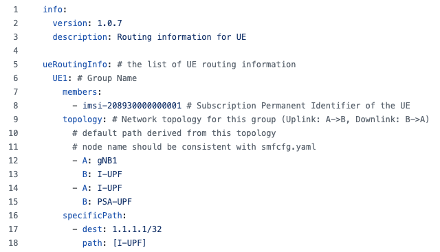
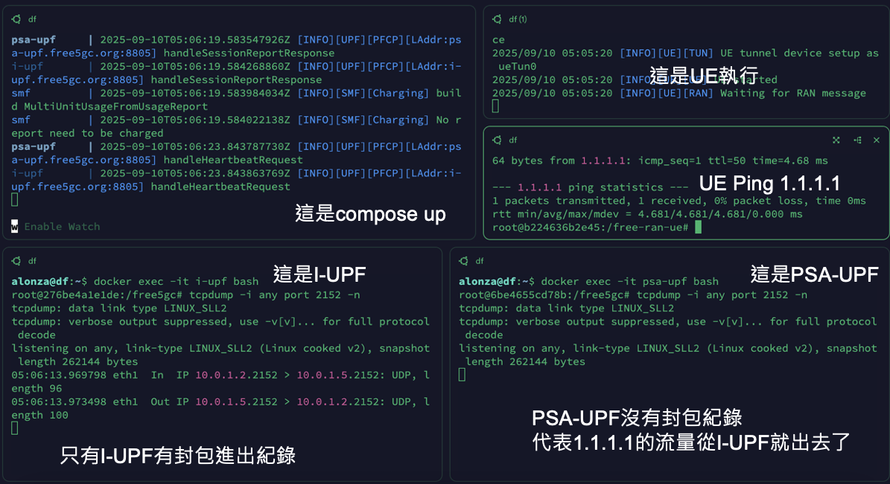
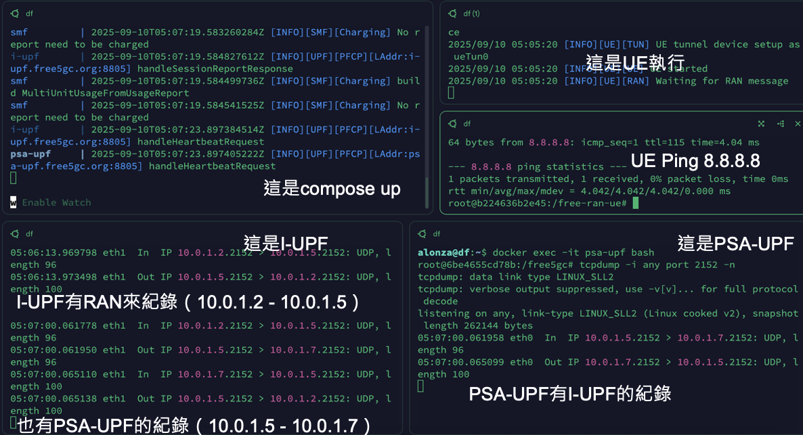

# Practice 3 - ULCL & Traffic Influence

**Deadline：2026/11/16**

## Description

ULCL（**U**p**L**ink **CL**assifier） 是一個可以透過多 UPF 做流量分流的一個 5G 機制，其核心目的是將流量從 I-UPF 分流至目標 DN，例如 MEC 平台或是某特定內網。

### Links

- [free-ran-ue Docker ULCL](https://free-ran-ue.github.io/doc-user-guide/11-docker-ulcl/)

### Architecture


### uerouting.yaml



- 定義所有符合 `1.1.1.1/32` 的流量都從 I-UPF 出去

### 參考指令

- Docker啟動
    ```bash
    docker compose –f <composeFile> up
    ```
- Docker關閉
    ```bash
    docker compose –f <composeFile> down
    ```
- UPF 安裝 tcpdump
    ```bash
    apt install tcpdump –y
    ```
- tcpdump監聽GTP port (2152)
    ```bash
    tcpdump –i <netIF> port 2152 -n
    ```
    
### Demo

- Specific Path
    
- Default Path
    


## E3 繳交

直接繳交截圖即可，截圖如 Demo 所示，截圖檔名以助教好理解就行。

重點是兩種 Path 上的 tcpdump 紀錄。