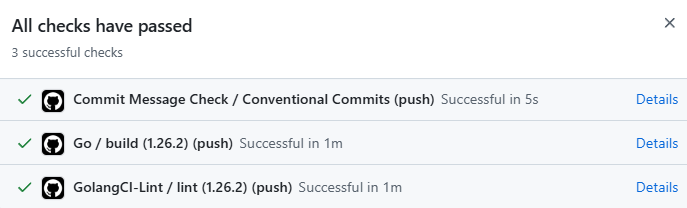

# Project 2 - Network Service Function
**Deadline：2026/11/9**

[TOC]

## 作業描述

某天一覺醒來，你穿越到了平行世界的 2018 年，成為 WIRELab 的一名碩士生。

在當天的 meeting 中，教授交給你一項任務：獨立完成 free5GC 的 NSF 開發，而距離專案截止只剩下三個禮拜。

幸運的是，前幾屆學長姐已經完成了大部分功能，包含 SBI、API、流程控制與資料模型等模組。經過檢查後，你發現唯一尚未完成的部分是 NSF 內部的 Context 管理機制。

面對一個陌生的程式碼庫、有限的時間，以及即將到來的 deadline，你將如何快速理解架構、設計資料結構，並完成 Context 模組的實作？

## 學習目標

1. Github & Git 的基礎操作
2. Github Action 的操作
3. Go & Go Test（unit test）& [Go Interface](https://hackmd.io/CnE_WGHXT-ip8-dv8mFgVg?both#Go-Interface)
4. Docker Image 的快速使用
5. Markdown 格式撰寫
6. 學習讀別人開發的專案並完成接續功能開發

## 目標任務步驟

1. 前往 [pj2-nsf](https://github.com/cndi-free5gc/pj2-nsf) 做 fork 與 clone
2. 開啟 Github Action，確認 workflow 可以在每一次 commit 正常運作
3. 完成所有 "TODO"（相關內容請參考 README 的說明）
    - `serviceContext.go`：整個 NSF 的核心功能
    - `dbIf`：go interface 的抽換使用
4. 使用 docker image 進行基本測試 - 可以確認是否拿到基本的 40%（相關內容請參考 README 的說明）
    
    > [!Note]
    > 請注意最後 github 上的 db_Type 必須使用 `bbolt`，使 dbContext 的 `dbIf` 是使用 bboltdb 來啟動，助教的測試 image 裡面不會有你們的 custom db 設定與環境

## 評分

- （0%）NSF 狀態 - `make lint`/`make`/`make test`
    - 這邊沒過就沒了
- （70%）測試 - 只有 0%/40%/70%，沒有部分給分
    - （40%）基本測試（Heartbeat/Register/Discovery/Deregister）
        - 建議截圖 local test 結果，以免助教這邊沒過就完全沒救
        - 會使用 `make run` 執行 NSF
    - （30%）隱藏測試（Group Discovery/NSF Recovery/...?）
- （20%）Github Action（Enabled/All Passed）
    - 建議截圖，以免不可預期的問題發生，e.g. 
- （10%）DB Interface 抽換（螢幕錄影）
    - 例如在 config.yaml 使用 MongoDB 抽換，在 service register 後使用 mongosh 以 CLI 取得資料

## 測試資訊

- 皆為理想測資，不存在亂七八糟的測資（e.g. ip 就是 x.x.x.x 的 string，port 為 int）
- 不會 de-register 尚未 register 的 service
- 不會做 update service
- 會 discover 尚未 register 的 service，但不會 group discover 尚未 register 的 service
- 期望的 http response 不應該出現 internal server error（參考 postman json）

## 繳交內容

一份 zip 檔案，壓縮檔中需要包含 Report.md 與截圖（如果 md 裡面有放的話）與 DB interface 抽換成功的螢幕錄影 mp4 檔案，Report.md 格式請參考：

請命名為：

```bash
<學號>.zip
    └─ Report.md
    └─ db.mp4
    └─ images...(圖片不規定命名，但是要在 Report 裡面看得到)
```

> [!Important]
> 1. 無需繳交程式碼，Report 裡面會需要你們放 github 連接，助教會去 clone，沒有放 link 或是 link 錯誤直接 0 分
> 2. 格式錯誤，造成助教的困擾 -10%（不接受任何理由）
> 3. MacOS 系統請注意壓縮後的層級問題（MacOS 好像會多一層？）

## 提問

請直接在 [pj2-nsf](https://github.com/cndi-free5gc/pj2-nsf) 的 [repo issue 頁面](https://github.com/cndi-free5gc/pj2-nsf/issues) 發起一個 issue，描述問題，如果一段時間沒有回你可以直接 at 助教（助教的 github：@d11nn）

如果是隱私一點的問題請使用 e3 寄信，非 e3 信件助教可以不回

## Go Interface

Interface 在 go 裡面是一個特殊的結構體，會透過定義 sub-function 的方式來讓調用的人不需要知道底層的實現邏輯，就可以直接調用。

舉例來說：

今天你是一個霸道總裁，你跟秘書說你想要一個寵物，他要能具有 “叫” 以及 “跑” 的功能，你並不關心具體是什麼寵物，只要他功能符合就是對的。這段話就是：

```go
type Pet interface {
    Yell()
    Run()
}
```

秘書隨後找了一隻狗，他具有 “叫” 以及 “跑” 的功能。這段話就是：

```go
type Dog struct {}

func (d *Dog) Yell() {
    fmt.Println("汪汪汪")
}
func (d *Dog) Run() {
    fmt.Println("GoGoGo 出發嘍")
}
```

秘書又找了一隻貓，同樣也具有 “叫” 以及 “跑” 的功能。這段話就是：

```go
type Cat struct {}

func (c *Cat) Yell() {
    fmt.Println("喵喵喵")
}
func (c *Cat) Run() {
    fmt.Println("本喵的速度是喵的7倍")
}
```

秘書將一狗一貓放入了總裁家那 300 坪的花園，每天根據總裁踏出家門的第一步是左腳還是右腳來為總裁搭配要帶哪一個寵物。這段話就是：

```go
func getPet(firstFoot *Foot) Pet {
    switch firstFoot {
    case left:
        return Dog
    case right:
        return Cat
    }
}
```

霸道總裁的你根本不在意是什麼寵物，你只需要在出場的時候讓你的寵物叫一聲來讓大家注意到你。這段話就是：

```go
func Show() {
    Pet.Yell()
}
```

當你坐在 500 坪的辦公室裡面，需要叫秘書進來的時候，你依舊不在意是什麼寵物，你只需要它快速的跑到辦公室外的秘書辦公桌叫呼叫秘書。這段話就是（別問為什麼不用手機，霸道總裁有自己的想法）：

```go
func FindSecretary {
    Pet.Run()
}
```

總結來說，能夠實現 interface 內定義的 function 的結構體，就是一個可以回傳到 interface 宣告的實例。
