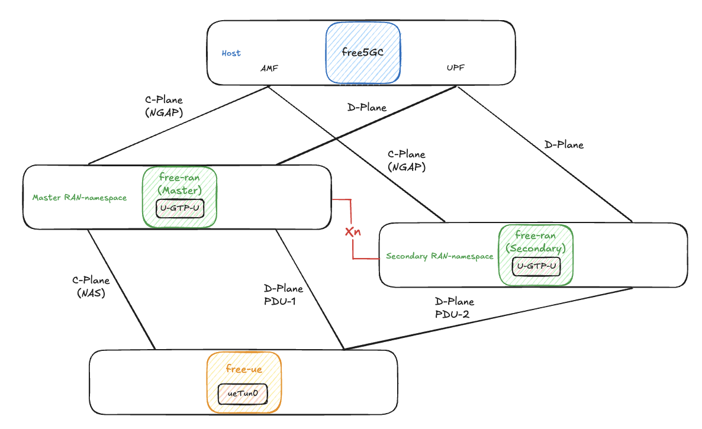
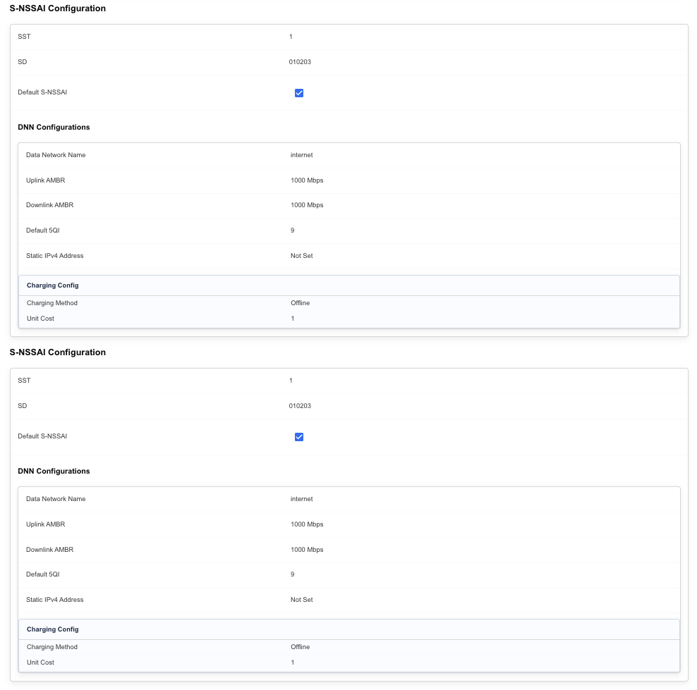

# Project 3 - NR Dual Connection

**Deadline：2026/12/7**

[TOC]

## 描述

你是一名出色的 5G R&D，秉持著只要講得出來就能做的出來的原則，主管將此次雙 PDU session 模擬器的任務交給了你。

目前市面上幾乎沒有可以支援雙 PDU sessin 的 UE，因此主管需要你透過爆改 free-ran-ue 的方式來提供核網做測試。同時還需要建立可以將第二個 PDU session 放到第二個 RAN 上的模擬。



## 學習目標

1. 理解 PDU 的建立操作
2. 將 5G 網路的知識進行實踐開發
3. 學習使用 tcpdump 與 wireshark 進行 icmp 封包解析
4. 理解一份開源專案並學習如何修改
5. 培養講得出來就做的出來的精神

## 目標任務

1. 前往 [pj3-dc](https://github.com/cndi-free5gc/pj3-dc) 做 fork 與 clone
2. 開啟 Github Action，確認 workflow 可以在每一次 commit 正常運作
3. 完成所有 TODO，裡面有注意事項與 hint，請認真查看喔～
4. 使用提供的測試腳本進行本地測試，可以確保你是否可以拿到 80%
5. 完成 Report 撰寫

## 評分

- （0%）Code Check - `make build`/`make test`/`make lint` / `make image`
    - 這邊沒過就沒了
- （60%）雙 PDU session 在同一個 RAN 上建立
    - 這邊失敗就不會繼續執行評分。
- （20%）第一條 PDU 在 master RAN 上，第二條 PDU 在 second RAN 上
    - 這邊失敗 Report 部分只會進行上一部分的 report 評分。
- （20%）Report.md 繳交
    - （5%）敘述雙 PDU session 建立方式
    - （5%）雙 PDU session 建立成功證明，包含 upf 與 ue 的 pcap 截圖
    - （5%）敘述雙 PDU session 做 DC 的建立方式
    - （5%）雙 PDU session 做 DC 建立成功證明，包含 upf 與 ue 的 pcap 截圖

## 測試資訊

測試與評分使用一樣的 code，但是助教測試方式是複製你們 free-ran-ue 的 code 做編譯，不會直接執行你們的整個資料夾（避免有人直接改測試）

測試內容分為三個部分：

1. 確認 code 可以執行 `make build`/`make test`/`make lint` / `make image`
2. 在 dc 設定為 false 的情況下對同一個 RAN 建立兩個 PDU session，並進行 ICMP 測試，確認 UPF 收到的封包來源正確
3. 在 dc 設定為 true 的情況下對兩個個 RAN 建立兩個 PDU session，並進行 ICMP 測試，確認 UPF 收到的封包來源正確

測試腳本完全公開，可自行查看。

free5GC 端的 subscriber 請使用 default 值，然後刪掉第二個 slice（112233），手動新增一個 010203 的 slice，flow rule 可刪可不刪，json 檔案請參考：[free5gc-console-subscriber-data.json](https://github.com/cndi-free5gc/pj3-dc/blob/main/test/free5gc-console-subscriber-data.json)，UI 參考如下：




## 繳交內容

一份 zip 檔案，壓縮檔中需要包含 Report.md 與截圖（如果 md 裡面有放的話），Report.md 格式不限，但需清楚描述與呈現實作方法與結果，且要讓助教看得懂（內容請參考“評分”），同時請命名為：

```bash
<學號>.zip
    └─ Report.md
    └─ images...(圖片不規定命名，但是要在 Report 裡面看得到)
```

> [!Important]
> 1. 無需繳交程式碼，Report 裡面會需要你們放 github 連接，助教會去 clone，沒有放 link 或是 link 錯誤直接 0 分
> 2. 格式錯誤，造成助教的困擾 -10%（不接受任何理由）
> 3. MacOS 系統請注意壓縮後的層級問題（MacOS 好像會多一層？）

## 提問

請直接在 [pj3-dc](https://github.com/cndi-free5gc/pj3-dc) 的 [repo issue 頁面](https://github.com/cndi-free5gc/pj3-dc/issues) 發起一個 issue，描述問題，如果一段時間沒有回你可以直接 at 助教（助教的 github：@d11nn）

如果是隱私一點的問題請使用 e3 寄信，非 e3 信件助教可以不回
